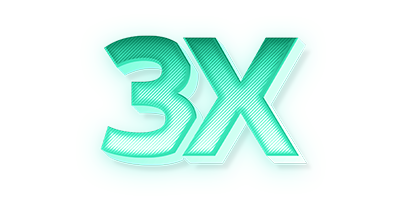

<p align="center">
  <picture>
    <source media="(prefers-color-scheme: dark)" srcset="./media/3x-ui-dark.png">
    
  </picture>
</p>

[](https://github.com/yodit10124/3x-ui/releases)
[](https://github.com/yodit10124/3x-ui/actions)
[](#)
[](https://github.com/yodit10124/3x-ui/releases/latest)
[](https://www.gnu.org/licenses/gpl-3.0.en.html)
[](https://pkg.go.dev/github.com/mhsanaei/3x-ui/v2)
[](https://goreportcard.com/report/github.com/mhsanaei/3x-ui/v2)

**3X-UI** — 一个基于网页的高级开源控制面板，专为管理 Xray-core 服务器而设计。它提供了用户友好的界面，用于配置和监控各种 VPN 和代理协议。

> [!IMPORTANT]
> 本项目仅用于个人使用和通信，请勿将其用于非法目的，请勿在生产环境中使用。

作为原始 X-UI 项目的增强版本，3X-UI 提供了更好的稳定性、更广泛的协议支持和额外的功能。

## 快速开始

```
bash <(curl -Ls https://raw.githubusercontent.com/yodit10124/3x-ui/main/install.sh)
```

## 特别感谢

- [alireza0](https://github.com/alireza0/)

## 致谢

- [Iran v2ray rules](https://github.com/chocolate4u/Iran-v2ray-rules) (许可证: **GPL-3.0**): _增强的 v2ray/xray 和 v2ray/xray-clients 路由规则，内置伊朗域名，专注于安全性和广告拦截。_
- [Russia v2ray rules](https://github.com/runetfreedom/russia-v2ray-rules-dat) (许可证: **GPL-3.0**): _此仓库包含基于俄罗斯被阻止域名和地址数据自动更新的 V2Ray 路由规则。_
